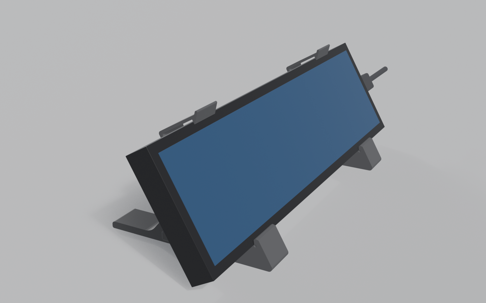

# Open Agent Deck

[](deskstand/README.md)

A native macOS app that turns a ~$110 touchscreen strip display (8.8" 480×1920 bar) into a live control deck for [Claude Code](https://code.claude.com): glanceable state for every running session, approve/deny from the strip, one-tap focus.

> The human is now the bottleneck in agentic coding — and the fix deserves dedicated glass, not another window buried behind the terminal.

## Requirements

- A Mac running **macOS 26 or later** and **Xcode 26 or later** (the package declares `swift-tools-version: 6.2` and `.macOS(.v26)`).
- [Claude Code](https://code.claude.com) (the `claude` CLI), which the deck supervises.
- cmux (the terminal app, expected at `/Applications/cmux.app`) as the terminal that hosts your Claude Code sessions. It is the only terminal host the deck supports today: it is how the deck finds a session's terminal, reads its prompt and types replies into it. Other terminals are not supported.
- Optional: the touchscreen strip itself. The deck is an ordinary resizable macOS window, so it runs on any display. See [Hardware](#hardware).

## Install

There are no releases yet, so the app is built from source. A signed, notarized download is the intent for a first release, not something that exists today.

```
git clone https://github.com/HectorZarate/openagentdeck.git
cd openagentdeck
open OpenAgentDeck.xcodeproj
```

Build and run the **OpenAgentDeck** scheme. From the command line:

```
xcodebuild build -project OpenAgentDeck.xcodeproj -scheme OpenAgentDeck -destination 'platform=macOS'
```

By default the app is signed ad hoc ("Sign to Run Locally"), which needs no Apple Developer account. To sign with your own team instead, copy `Config/Local.xcconfig.example` to `Config/Local.xcconfig` (git-ignored) and set your team ID. See [`Config/Signing.xcconfig`](Config/Signing.xcconfig).

The app is not sandboxed: it edits `~/.claude/settings.json` and drives other processes, neither of which App Sandbox allows. Hardened runtime is enabled for team-signed builds; Xcode disables it for the default ad-hoc signature.

## First launch, and what it changes on your Mac

On launch the deck starts listening and shows your running Claude Code sessions. It changes nothing in `~/.claude` until you press **Connect** on the empty-state card (or in Settings), which shows what it will add first.

- **Hooks in `~/.claude/settings.json`.** Connecting adds one entry per hook event (`PermissionRequest`, `PreToolUse`, `Notification`, `UserPromptSubmit`, `SessionStart`, `Stop`, `SessionEnd`, `PostToolUse`). Each is a `curl` that posts the event to the deck on `127.0.0.1`. Every entry the deck writes carries the marker key `"x-openagentdeck": true`. Other keys and hooks are preserved (the one exception, a wrapped statusline, is described below), and each write first copies the previous file to `settings.json.<n>.bak` beside it (`<n>` counts writes since the app launched, so a later launch can overwrite an older backup).
- **Statusline wrapper.** If you already have a `statusLine` command, it is wrapped so the same payload is also forwarded to the deck; your command still renders its own output, and its command string is stored alongside under `x-openagentdeck-original`. The wrapper is rebuilt with only `type` and `command`, so any other keys on your `statusLine` object (such as `padding`) are dropped, and Disconnect does not restore them. If you have no statusline, the Connect card offers to add one with "Also add a statusline" already ticked; untick it to skip.
- **Once connected, launch repairs drift.** If a connected deck finds its own entries out of date (for example a hook event added by a newer version of the deck), it fixes them on launch, provided the installed hooks point at the port the deck is listening on. It never connects on its own.
- **A loopback HTTP server** on `127.0.0.1`, default port `8765` (override with the `OAD_HOOK_PORT` environment variable). It accepts hook events and can answer permission requests, so it listens on loopback only. The deck makes no other network connections and has no telemetry.
- **Processes it runs:** `claude agents --json` (to list sessions). The `claude` binary is found in known install paths, then with `/bin/zsh -lic "command -v claude"`, an interactive login shell that sources your shell rc files (`~/.zshrc`), and as a last resort through `/usr/bin/env`. Also `/bin/ps`, and the `cmux` CLI (`/Applications/cmux.app/...`, or the path in `CMUX_BUNDLED_CLI_PATH`) to read a session's screen and to type text into it when you tap a reply or quick action. The crash watchdog (below) also runs `/bin/sh` and `/usr/bin/open`.
- **Files it reads or writes:** reads session transcripts under `~/.claude/projects/` (to show recent prompts and detect API errors); writes a log to `~/Library/Logs/OpenAgentDeck.log` (diagnostics are designed to exclude prompt and command content); keeps preferences in the `com.openagentdeck.prefs` defaults domain; and keeps two small crash-recovery marker files (`clean-exit`, `crash-relaunches`) in `~/Library/Application Support/OpenAgentDeck/`.
- **Crash recovery.** If the app crashes, a small watchdog relaunches it through a detached `/bin/sh` and `/usr/bin/open`. It does not arm when `OAD_HOOK_PORT` is set, under a debugger, in Xcode previews or under XCTest.
- **Optional login item**, off by default. It is a toggle in Settings ("Open Open Agent Deck at login") and is also offered, unticked, on the Connect card when you have no statusline.

### Uninstall

1. In the deck, open **Settings** and press **Disconnect…**. This removes exactly the hook entries the deck added, restores your original statusline (or removes the one it added), and releases any session waiting on the deck back to its own terminal.
2. Turn off the login item in Settings if you enabled it, quit the app, and delete it.
3. Optional: delete the leftovers: `defaults delete com.openagentdeck.prefs`, `~/Library/Application Support/OpenAgentDeck/`, and `~/Library/Logs/OpenAgentDeck.log`.

If you can no longer run the app, remove the entries by hand from `~/.claude/settings.json`: under `hooks`, delete every entry containing `"x-openagentdeck": true` (or a command posting to `http://127.0.0.1:<port>/hook`); and if `statusLine` has `"x-openagentdeck": true`, set `statusLine` to `{"type": "command", "command": <the string in its x-openagentdeck-original field>}` (or delete `statusLine` if the deck added it and there is no original). The `settings.json.<n>.bak` files beside the settings file are earlier versions you can restore instead. Claude Code may strip the marker keys when it rewrites the file; the `curl ... 127.0.0.1` commands remain recognizable.

## Hardware

The deck is designed for an 8.8" 1920x480 IPS touchscreen bar (typically $90-140 on Amazon; about $110 for the model it was built around). The model it was built around is a USB-C unit that carries power, DisplayPort video and touch over a single cable. Short version of the [hardware research](docs/research/02-strip-display-hardware.md):

- Buy a **true monitor**, not a "smart screen". Turing Smart Screen / TURZX units look the same but are USB-serial devices that a host program pushes images to; macOS does not see them as a display.
- USB-C models need a **direct, full-featured USB-C port** (no hub, dock or adapter); on a desktop Mac use a rear Thunderbolt port. HDMI-plus-USB models also work for video.
- **Touch on macOS is the risk.** macOS has no native touchscreen stack, and the research found no confirmed report of out-of-the-box touch on these strips. The deck is a normal window, so a mouse works everywhere; touch needs the strip's controller to be delivering pointer events (some units do, a third-party touch driver can fix the rest).
- A 3D-printed [snap-clip desk stand](deskstand/README.md) for the strip is included.

## Tests

```
swift test --package-path Packages/DeckKit      # fast loop, most of the suite
```

In Xcode, `⌘U` runs the default **OpenAgentDeck** test plan, which covers the three package test targets (`DeckCoreTests`, `DeckAdaptersTests`, `DeckAppTests`). The UI tests are a separate **UITests** plan that launches the app. See [CONTRIBUTING.md](CONTRIBUTING.md).

## Structure

```
OpenAgentDeck.xcodeproj   the app target: bundle identity, hardened runtime
Config/                   signing configuration (xcconfig)
App/                      the @main, and the asset catalog
Packages/DeckKit/         every line of logic, and its tests
UITests/                  the layer that needs a launched application
deskstand/                the 3D-printed desk stand (Blender + Python)
docs/                     product brief, UX spec, architecture, research
```

`DeckKit` is layered innermost-first, and the manifest enforces it rather than a convention: `DeckCore` declares no dependencies, so it *cannot* import anything above it. See [docs/ARCHITECTURE.md](docs/ARCHITECTURE.md).

| Module | What it is |
|---|---|
| `DeckCore` | Model, reducer, layout, projection. Pure: no I/O, no clock, no platform framework. |
| `DeckPorts` | The protocols the core is spoken to through. |
| `DeckAdapters` | The implementations that touch the world: hook server, config files, the `claude` CLI, the cmux host. |
| `DeckApp` | The runtime that wires them together, and every SwiftUI view and scene the app shows. |

The app target holds the `@main` and nothing else, because everything a library can hold is testable without launching an app. Rendering is asserted headlessly through `ImageRenderer` (contrast, ink coverage, whether a region is a button), so the UI tests only cover what a running application can show.

## Contributing

See [CONTRIBUTING.md](CONTRIBUTING.md) and the [Code of Conduct](CODE_OF_CONDUCT.md). Report security issues as described in [SECURITY.md](SECURITY.md).

## Docs

- [Product brief](docs/PRODUCT_BRIEF.md) — vision, principles, architecture, risks, roadmap
- [UX design spec](docs/UX_DESIGN.md) — layout, state vocabulary, approval takeover, gesture grammar, edge cases
- [Strip UI state board](design/strip-states.html) — 1920×480 mockups of the five key states (open in a browser)
- [Architecture](docs/ARCHITECTURE.md) — module layering, data flow, glossary
- Research: [Codex Micro](docs/research/01-codex-micro.md) · [Strip hardware & macOS](docs/research/02-strip-display-hardware.md) · [Claude Code integration surface](docs/research/03-claude-code-integration.md) · [Competitive landscape](docs/research/04-competitive-landscape.md) · [Spike results](docs/research/09-spike-results.md)
- [Desk stand](deskstand/README.md) — the 3D-printed snap-clip stand for the strip shown above (A1 mini, PLA, settings embedded)

## The idea in one image

Three Claude Code sessions breathing on the strip; one flips amber showing `git push --force`; you tap **Deny** without leaving your editor.

Inspired by the [Codex Micro](https://worklouder.cc/codex-micro) — rebuilt the way reviewers said it should have been: dynamic display instead of keycaps, unlimited sessions instead of six, documented hooks instead of a proprietary protocol, open source instead of $230.

## License

[Apache-2.0](LICENSE). Chosen over MIT for its explicit patent grant, which matters for a project that touches HID and may attract vendor attention. Any commercial dependency — the UPDD touch driver in particular — stays behind an optional adapter boundary and is never required to build or run the deck.
