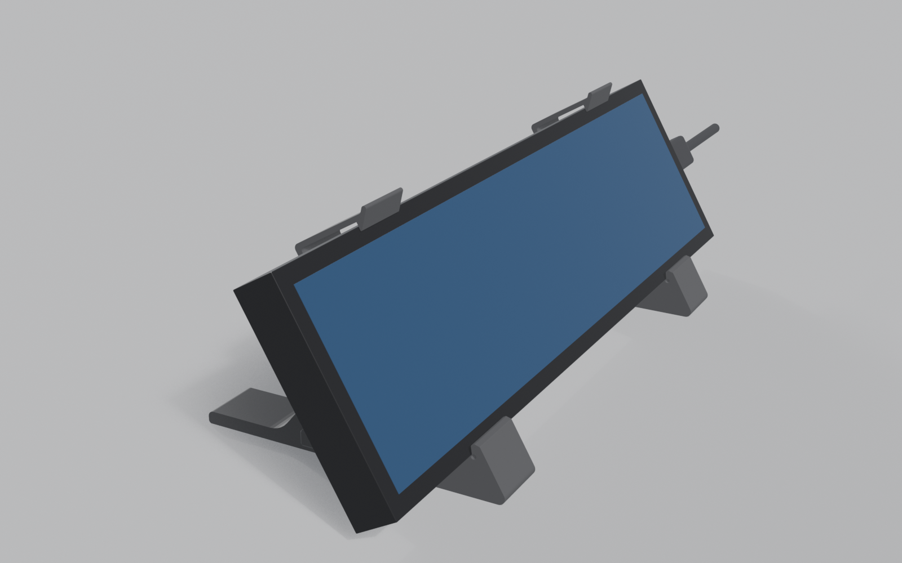
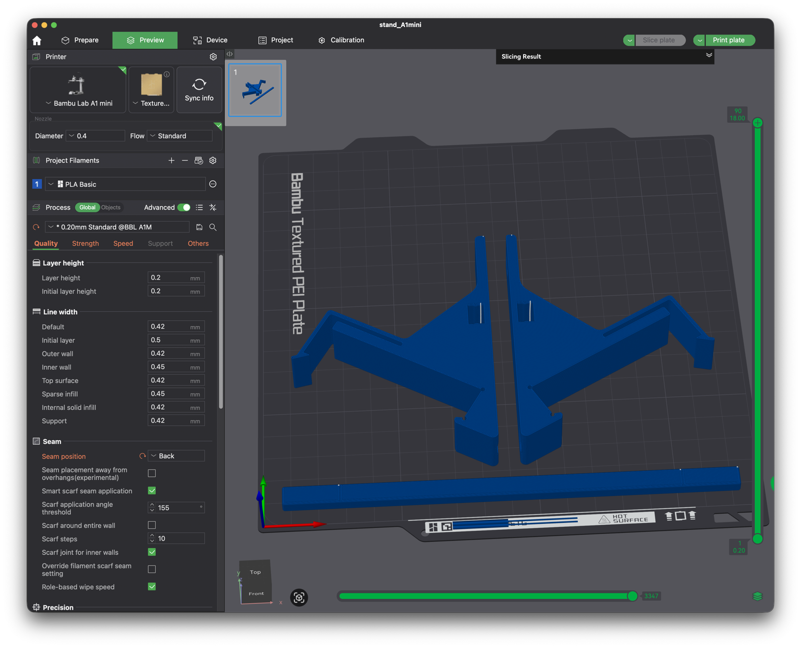

# Snap-clip desk stand

A 3D-printed stand that holds the 8.8" strip display at 60°. It has two feet with
spring clips plus one tie rod, and all three print together on an A1 mini plate
in PLA with no supports.

Open `out/stand_A1mini.3mf` in Bambu Studio. The print settings are built in: the
process shows as a modified **0.20mm Standard @BBL A1M**, as in the screenshot,
with the seam on the back.

- **[PRINTING.md](PRINTING.md):** how to measure the display, the settings and why,
  the first-print checks, snap-fit numbers and assembly.
- **`stand.py`:** the parametric generator. Run
  `blender -b -P stand.py -- --out out`. Every dimension is a parameter in `P`.
- **`tools/regress.sh`:** rebuilds the stand across the whole fit range.

## Requirements

Only needed to regenerate the stand or the renders; to print it, open
`out/stand_A1mini.3mf` in Bambu Studio and nothing else.

- **Blender** on your `PATH` as `blender` (developed with 5.2.x). `stand.py`
  runs inside Blender's Python, so it needs no extra packages.
- **Python 3 with Pillow** for `tools/contact_sheet.py` (`pip install pillow`).
  `tools/make_3mf.py` and `tools/flatten_profile.py` use only the standard library.
- **zsh** (the macOS default shell) for `tools/regress.sh`.
- **Bambu Studio** to open and slice the plate. `tools/flatten_profile.py` takes
  a system preset folder from a Bambu Studio install
  (`profiles/BBL/<kind>`, e.g. its `process` folder) plus a preset name and
  writes a flattened copy with the `inherits` chain resolved (the Bambu Studio
  CLI crashes on presets that inherit from parents).
