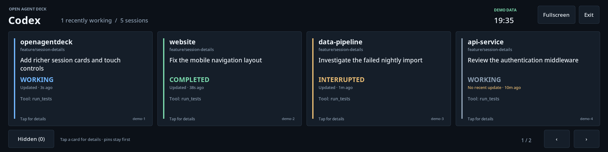
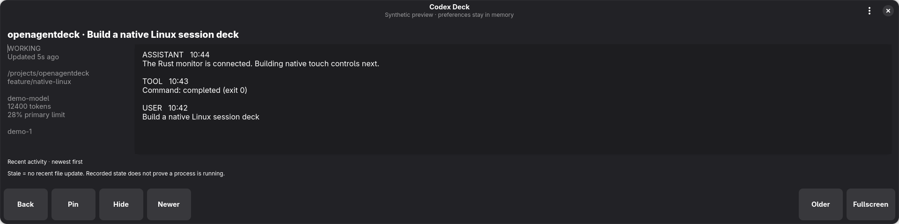

# Codex monitor for Linux

A native **Rust + GTK 4 + libadwaita** application for monitoring existing local
Codex sessions. It follows GNOME's appearance, window controls, keyboard focus,
and accessibility conventions, and runs directly on Wayland. The strip layout
targets **1920 × 480**, with fewer cards and a compact detail view in smaller windows.
Both the monitoring backend and interface run in one compiled application.
No API key or Codex configuration changes are required.

## Build and run

Requires Rust 1.92+, GTK 4.12+, and libadwaita 1.5+. On Fedora:

```sh
sudo dnf install gcc pkgconf-pkg-config gtk4-devel libadwaita-devel
./linux/run.sh                              # native application
./linux/run.sh --demo                       # synthetic data; no personal files
./linux/run.sh --list-monitors              # enabled outputs only
./linux/run.sh --json                       # one Rust backend snapshot
./linux/run.sh --sessions-dir /path/to/codex/sessions
./linux/run.sh --size 800x400
```

The launcher uses Cargo with the committed lockfile. Standard Cargo commands
work too: `cargo build --locked --release --manifest-path linux/Cargo.toml`, then
run `linux/target/release/openagentdeck`. The resulting binary needs the GTK and
libadwaita runtime libraries; Cargo is only needed to build it. The launcher also accepts
local development metadata under
`$XDG_CACHE_HOME/openagentdeck/devel/usr/lib64/pkgconfig` (default `~/.cache`).
That optional development cache is machine-local and is not shipped in the repo.

## Checks

```sh
cargo test --locked --manifest-path linux/Cargo.toml --no-default-features
# With GTK development dependencies installed:
cargo test --locked --manifest-path linux/Cargo.toml
./linux/run.sh --demo --smoke-test /tmp/deck-preview
```

The native smoke check opens a normal window using synthetic data, checks card
activation, pin/hide/restore, stable history scrolling, compact layout, and an
unavailable display selection, then saves PNG previews and closes. It requires
a graphical session; it never enables a monitor or enters fullscreen. Backend
tests run without a display or GTK using `--no-default-features`.

## Session cards and details



Cards show the project, recorded branch, session title (or latest available
prompt), state, freshness, and a recent activity preview. Tap anywhere on a card
to open its details. Titles come from Codex's `session_index.jsonl` when present;
title changes appear even when the session's rollout has not changed.



The detail view shows up to 12 recent messages/activity records, newest first,
plus the latest observed prompt or error if it has fallen out of that list. Use
**Older/Newer**, touch scrolling, the scrollbar, or the mouse wheel to read more. Text is selectable
and read-only. While browsing older messages, updates wait until you return to
the top so the text does not jump under you. **Back** or **Esc** returns to the cards; Esc from the overview
leaves fullscreen.

- **Pin / Unpin:** keep an important session ahead of unpinned cards. Pins are
  session-specific. Standard rollout filenames let the scanner find older pinned
  sessions outside its usual recent-file shortlist, within the 48-session limit.
- **Hide:** remove a session from the main view without touching it in Codex.
- **Hidden:** browse hidden sessions still in the current scan. Tap one and use
  **Show again** to restore it. **Restore all** also clears hidden IDs for sessions
  outside the scan.

Choices survive restarts in `$XDG_CONFIG_HOME/openagentdeck/preferences.json`
(normally `~/.config/openagentdeck/preferences.json`). Only session IDs and deck
preferences are saved, not prompts or replies. Writes replace the file atomically.
An unreadable or invalid existing file is left untouched and reported in the UI.
Use `--preferences-file /path/to/preferences.json` to choose another location.
Demo mode keeps its choices in memory and never writes preferences.

## Put the dashboard on the USB-C strip

1. Connect the display to a USB-C port with video output. In Linux display
   settings, extend the desktop and rotate the strip to **1920 × 480 landscape**.
   The panel reports its native mode as **480 × 1920**, so rotation is expected.
2. Run `./linux/run.sh`. In the header's **Display options** menu, select the
   strip's connector, then tap **Fullscreen** or press **F11**. Alternatively,
   drag the window to the strip and fullscreen on **Current display**.
3. From the overview, **Esc** leaves fullscreen; close using the native window
   controls. **Previous/Next**, keyboard arrows, or a horizontal touch swipe page
   through cards. Check that a tap on a control lands on that control; touchscreen
   mapping belongs to your desktop settings.

```sh
./linux/run.sh --list-monitors
./linux/run.sh --monitor DP-3 --fullscreen
```

Only already enabled outputs are listed. An unavailable requested output leaves
the app windowed with a notice; losing a selected output exits fullscreen. The
compositor ultimately decides window placement and fullscreen. Wayland does not
allow arbitrary application-chosen window coordinates. Use `--size WIDTHxHEIGHT`
for the window dimensions and `--monitor` to select a fullscreen output.

**The app never changes display layout, rotation, touchscreen mapping, or KVM
settings.** Validation of this migration used a normal window on the main GNOME
Wayland display. The strip remains disabled on the development machine because
of the Comet issue below. Physical touch gestures, display hotplug/fullscreen,
other desktops, and display scaling still need hardware validation.

### GL.iNet Comet / absolute KVM mouse

On the development machine, extending the desktop below the Comet-captured
2560 × 1440 display caused the Comet's absolute mouse position to become offset.
Returning to the main-display-only layout restored alignment. Mapping the strip's
touchscreen to its output does not constrain the separate Comet mouse.

Before extending this desktop again, test **Mouse → Mouse Mode → Relative** in
the Comet console. GL.iNet documents relative mode as movement-based rather than
screen-coordinate-based; click inside the remote view to capture it and press
Esc to release. This workaround has not yet been validated with both displays on
this machine. If absolute mode is required, keep the strip disabled until a
verified per-device mapping solution is available. Do not assume `xinput` can
remap the physical device in a GNOME Wayland session.

Reference: [GL.iNet mouse modes](https://docs.gl-inet.com/kvm/en/faq/difference_between_absolute_and_relative_mouse/).

During development, Linux detected the reference hardware as an LZT
`HSD088IPW1-A` display and a TeNizo `1a86:e5e3` touchscreen. The developer desktop
was temporarily rotated with Mutter's display configuration API and its GNOME
touch mapping set to that display. To return that device to automatic mapping:

```sh
gsettings reset org.gnome.desktop.peripherals.touchscreen:/org/gnome/desktop/peripherals/touchscreens/1a86:e5e3/ output
```

The graphical view shows up to 48 root sessions, four per page at strip
width. Pins sort first, then fresh working observations. Hidden sessions still
count toward the scan limit. Updates are read on a background
Rust worker thread so filesystem scanning does not block touch interaction. The
GTK main thread owns all widgets; bounded snapshots cross a channel. The
observation semantics and limitations are described below.

The default source is `$CODEX_HOME/sessions`, or `~/.codex/sessions` when that
variable is unset. `--json` emits one snapshot without opening a window.
Refresh is every two seconds; `--interval`, `--limit`, and `--stale-after`
are configurable.

## What the display means

- **Last state:** the latest recognized lifecycle event in the file tail:
  working, completed, interrupted, error, or unknown. Completed means a turn
  completed, not that the session or terminal has exited.
- **Stale:** no file modification within 120 seconds by default. Working is a
  recorded observation, not proof of a live process. A silent long-running turn
  and a crashed process cannot be distinguished from these files alone.
- **Project/model:** recorded working directory and model, when available.
- **Branch/title/prompt:** recorded metadata and message previews, not a live Git
  query. A branch can be old; absent titles fall back to the latest prompt observed
  within the bounded file tail.
- **Tokens:** last recorded cumulative session token total, not context occupancy.
- **Limit:** last reported primary rate-limit window usage. This can be old,
  applies beyond a single session, and must not be added across rows.

Recent sessions are sorted by file modification time. Subagents are hidden by
default. Archived sessions and sessions on other machines are not included.
The graphical view and JSON output include bounded user prompts, assistant
messages, error messages, local project paths, and session IDs. Treat these like
the underlying conversation when sharing a screenshot or JSON snapshot. Reasoning
records, system/developer instructions, raw tool arguments, and raw tool output
are not included. Tool activity shows names and completion status only. Message
previews stay in memory and are not written to deck preferences or diagnostics.

## Integration boundary and limitations

The monitor reads local rollout JSONL records observed with **codex-cli
0.166.0**. This storage format is an internal, version-sensitive adapter, not a
promised public API. Sessions that use another storage format or home directory
may not appear. Unknown records are ignored; missing evidence stays unknown.

Reads are bounded to a 1 MiB metadata header and a 512 KiB tail per changed file.
Unchanged files are cached. Scanning stats all JSONL files, then reads at most
`max(100, limit * 10)` recent candidates plus pinned filenames per refresh; very large histories may
still make discovery slow. Metadata above the header bound is skipped. If a turn
start, model, or usage record has fallen outside the tail, that field can be
unknown. Partial final records wait until their newline arrives. Missing and
unreadable files are handled without modifying them. Title-index reads are capped
at the last 1 MiB; older titles outside that window may be unavailable. Message
previews are capped at 2,000 characters each, with at most 12 activity entries.

There are no approvals, terminal input, session resume, hooks, listeners, or
inference calls in this milestone. Codex files are only opened for reading; only
the deck's own pin/hide preferences are written.

Codex's [documented app-server protocol](https://learn.chatgpt.com/docs/app-server)
provides thread listing, reading, runtime status, and approval handling. Runtime
status belongs to the server hosting that thread. A newly spawned app-server
must not be assumed to report the live state of every independently running CLI
or desktop session. A future adapter should validate connection to the existing
owning server before offering live status or controls; monitoring must not resume
threads to manufacture visibility.

## Port direction

1. **Implemented:** discover existing Codex sessions and validate an honest,
   read-only state model on Linux, with synthetic regression fixtures.
2. **Implemented native port:** a Rust monitoring library and GTK/libadwaita app,
   with richer cards, expandable details, compatible saved pins/hiding, native
   selectable text, touch scrolling/paging, and fullscreen output selection.
   Validate daily use and physical touch on the strip before expanding controls.
3. Add verified owning-server observation where available, with explicit source
   and freshness indicators.
4. Consider approval controls separately once ownership, routing, and reconnect
   behavior are demonstrated. Monitoring existing sessions remains the default.

The upstream SwiftUI app remains the Claude/macOS implementation. Its UI concepts,
state-machine design, and regression scenarios guide this port; SwiftUI, AppKit,
cmux routing, and Claude hook installation are not Linux dependencies. The
upstream Apache-2.0 license, NOTICE, and hardware stand assets remain in place.

## Source layout

- `src/model.rs`: pure session reducer and bounded, human-facing history.
- `src/monitor.rs`: read-only rollout adapter, discovery cache, and title index.
- `src/preferences.rs`: compatible deck-only pin/hide storage with atomic writes.
- `src/ui.rs`, `src/style.css`: GTK/libadwaita widgets and background observation.
- `src/main.rs`: CLI options, native startup, and headless JSON snapshots.
- `tests/backend.rs`: synthetic regression cases, runnable without GTK.

GTK and libadwaita provide native GNOME controls and touch input; this is not a
webview. Rust offers typed state and a compiled deployment, while the pure backend
stays independent of the UI. The rollout format remains the version-sensitive
integration boundary regardless of implementation language.
